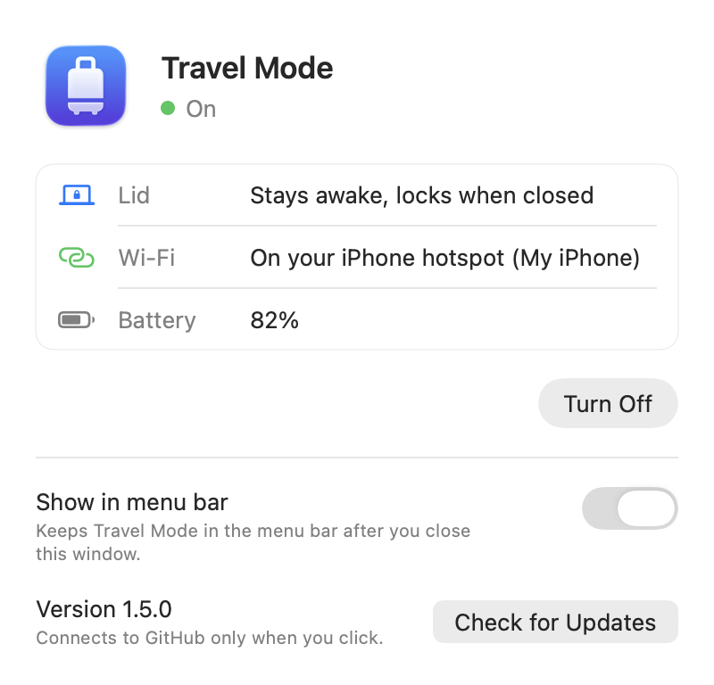

<p align="center"></p>

# Travel Mode for Mac

Close your MacBook's lid and keep it working: long downloads, builds, AI coding sessions you
follow from your phone. Travel Mode keeps the Mac awake with the lid closed, **locks the screen
when you close it**, and tells you whether Wi-Fi is on your **iPhone Personal Hotspot**.

<p align="center">
  <picture>
    <source media="(prefers-color-scheme: dark)" srcset="assets/screenshot-dark.png">
    
  </picture>
</p>

## Why

macOS always sleeps when you close the lid, unless an external display is plugged in.
`caffeinate` and most "keep awake" apps only stop *idle* sleep, not lid-close sleep.
Travel Mode uses the built-in `pmset disablesleep` switch, and adds what you want on the road:
an automatic screen lock and a hotspot check.

## What it does

| | |
|---|---|
| **Stays awake with the lid closed** | `pmset -a disablesleep 1` while on, back to normal when off |
| **Locks on lid close** | A small background watcher locks the screen within about 2 seconds of the lid closing |
| **Hotspot check** | Shows "On your iPhone hotspot", or a warning to join it from the Wi-Fi menu |
| **Wi-Fi log** | While on, notes when Wi-Fi drops and how long until it's back |
| **Battery at a glance** | Shown in the window and the menu bar menu |
| **Menu bar icon (optional)** | A suitcase icon, filled when on, with Turn On / Off in its menu |
| **Survives restarts** | If you restart while it's on, the watcher comes back on its own |
| **Update check** | Click **Check for Updates** to see if there's a newer release, with a link to it on GitHub |

The app asks for your Mac password (the normal macOS dialog) each time you turn it on or off.
Your password goes to macOS, never to the app. If the screen lock can't start, Travel Mode
turns normal sleep straight back on rather than leave an unlocked Mac awake, and the window
warns you if the lock ever stops while Travel Mode is on.

## Install

Requires macOS 13 or later on Apple silicon or Intel, and an administrator account.

### From the disk image

1. Download `Travel-Mode-<version>.dmg` from the
   [Releases](https://github.com/ahendraatmaja/mac-travel-mode/releases) page and open it.
2. Drag **Travel Mode** onto **Applications**, then eject the disk image.
3. Open Travel Mode from Applications.

**First launch:** the app isn't notarised by Apple yet, so macOS says it can't verify it.
Click **Done**, open **System Settings > Privacy & Security**, scroll down to the message about
Travel Mode, click **Open Anyway** and confirm with your password. You only do this once.
(Comfortable in Terminal? `xattr -dr com.apple.quarantine "/Applications/Travel Mode.app"`
does the same.)

To use the `travel-mode` command as well:
`ln -s "/Applications/Travel Mode.app/Contents/Resources/bin/travel-mode" ~/.local/bin/travel-mode`

### From source

Needs the Xcode Command Line Tools (`xcode-select --install`).

```bash
git clone https://github.com/ahendraatmaja/mac-travel-mode.git
cd mac-travel-mode
./install.sh
```

This builds **Travel Mode.app** (a small native Swift app) into `~/Applications` and adds the
`travel-mode` command in `~/.local/bin`. Running `./install.sh` again upgrades in place, even
while Travel Mode is on. A source build runs without the first-launch approval.

Nothing is downloaded at install time. While Travel Mode is off, nothing runs in the background
(the app itself only if you keep it open in the menu bar).

## Use

**App:** press Cmd+Space, type "Travel Mode", press Return. It's a normal Mac window with the
usual close, minimise and zoom buttons (Cmd+W, Cmd+M, Cmd+Q work too).

**Menu bar:** switch on **Show in menu bar** to keep a suitcase icon in the menu bar (filled while
Travel Mode is on). Its menu shows the status, Turn On / Off, Check for Updates and Open. With
the icon on, closing the window keeps Travel Mode in the menu bar; with it off, closing the
window quits the app. To have the icon after a restart, add Travel Mode to **System Settings >
General > Login Items**.

**Command line:**

```text
travel-mode on | off | toggle | status
travel-mode wifi              hotspot / other / off / none, plus a message
travel-mode log               recent lid locks and Wi-Fi changes
```

## Updates

Click **Check for Updates** at the bottom of the window (also in the **Travel Mode** menu and the
menu bar menu). It asks GitHub for this repository's latest release and shows either "You're up
to date" or the new version with a **View on GitHub** link. If the check can't get through
(offline, a hotel Wi-Fi sign-in page, GitHub busy), it says why and links to the releases page so
you can look yourself. Travel Mode never checks on its own, and never downloads or installs
anything itself.

To update: download the new disk image from the release page, quit Travel Mode, drag the new
Travel Mode onto Applications and choose **Replace**. Your settings stay. If Travel Mode was on,
it keeps running, and the background watcher switches to the new version the next time you open
the app. From source: `git pull`, then `./install.sh`.

Want to hear about new versions without checking? On GitHub, click **Watch > Custom > Releases**
on this repository.

## Getting on your hotspot, and back on after a drop

Join your iPhone's hotspot from the **Wi-Fi menu** in the menu bar, under Personal Hotspot.
Travel Mode shows a warning while you're on anything else.

To have the Mac rejoin the hotspot by itself when Wi-Fi drops, open **System Settings > Wi-Fi**
and set **Ask to join hotspots** to **Automatic** (macOS 26 or later; older versions word it
differently). macOS then reconnects the same way the Wi-Fi menu does. If another saved Wi-Fi
network is in range, macOS may choose that one instead.

Travel Mode doesn't join networks itself. When your iPhone and Mac share an Apple Account, the
hotspot password comes from iCloud, and the command-line tool for joining networks can't use it
(it fails with error -3900). While Travel Mode is on, it notes every Wi-Fi change in its log
instead, so you can see when Wi-Fi dropped and how long until it was back (`travel-mode log`).

To keep the hotspot from switching off: on the iPhone, open **Settings > Personal Hotspot**, turn
on **Allow Others to Join** and **Maximize Compatibility**, and avoid Low Power Mode while
travelling. A USB cable to the iPhone is the most reliable of all, and Travel Mode recognises it
as your hotspot too.

## How the hotspot check works

On recent macOS versions, the name of the current Wi-Fi network counts as location data and is hidden
from scripts (`<redacted>`) unless you grant Location Services. Travel Mode doesn't need it:
an iPhone or iPad Personal Hotspot always uses the `172.20.10.0/28` network with router
`172.20.10.1`. Travel Mode reads each network interface's own router address, so a VPN doesn't
confuse it.

To show the network's name, a small helper (`wifiname`) reads it from the copy of the current
network's details that macOS keeps in its network state, with no extra permissions. The name is
only displayed, never stored. If a future macOS hides it there too, the window just leaves the
name out.

Android hotspots use other addresses and show as "another Wi-Fi network". Any network can hand
out the iPhone's addresses, so a lookalike would show as a hotspot too.

## Privacy

- Travel Mode has no accounts, analytics or tracking.
- It goes online only when you click **Check for Updates**: one anonymous request to
  `api.github.com` for this repository's latest release. Like any web request, GitHub sees your IP
  address; the app sends nothing else about you or your Mac.
- The event log stays on your Mac (see "Files it touches") and is deleted when you uninstall.
- It never joins, changes or forgets Wi-Fi networks.

## Travel tips

- **Heat:** a closed laptop in a bag has little airflow. Light work is fine; avoid long heavy
  workloads inside a tight sleeve.
- **Battery:** it never sleeps while on, even on battery. Turn it off when you arrive.
- **Internet:** connect to your hotspot *before* closing the lid, so Travel Mode learns it.

## Uninstall

In the app, choose **Travel Mode > Uninstall Travel Mode…** (or run `./uninstall.sh` from the
source folder). Either way it restores normal sleep (asking for your password if Travel Mode is
on) and removes the app, the command, the background watcher and the settings.

Please don't just drag the app to the Trash while Travel Mode is on: your Mac would stay set to
never sleep. If that happens, run `sudo pmset -a disablesleep 0` in Terminal.

## Files it touches

| Path | What |
|---|---|
| `~/Applications/Travel Mode.app` | The app (the scripts live inside it) |
| `~/.local/bin/travel-mode` | Link to the command |
| `~/Library/LaunchAgents/io.github.ahendraatmaja.mac-travel-mode.lid-lock.plist` | The watcher (lid lock + Wi-Fi log), only while on |
| `~/Library/Logs/travel-mode.log` | Lid locks and Wi-Fi changes (trimmed to the newest 1000 lines past 512 KB) |
| `~/Library/Preferences/io.github.ahendraatmaja.mac-travel-mode.plist` | The "Show in menu bar" choice and window position |
| System power setting `SleepDisabled` | Set to 1 while on, 0 when off |

## Development

`./test.sh` replays Wi-Fi sequences (hotspot drop and recovery, long outage, switching networks,
Wi-Fi off) through the watcher with a simulated clock, and checks the launchd file for unusual
install folders. It changes nothing on your Mac.

The app is one Swift file (`src/app/main.swift`) driving the `travel-mode` script. `./build.sh`
builds a universal app (Apple silicon + Intel); `./make-dmg.sh` wraps it in a drag-to-Applications
disk image (`build/Travel-Mode-<version>.dmg`), and signs and notarises it when `SIGN_IDENTITY`
and `NOTARY_PROFILE` are set (see the script). In a fork, build with
`UPDATE_REPO=<owner>/<repo> ./build.sh` so the update check follows your releases; run
`"build/Travel Mode.app/Contents/MacOS/TravelMode" --check-update` to test it. To redraw the
README screenshots: `"build/Travel Mode.app/Contents/MacOS/TravelMode" --snapshot out.png --demo`
(add `--dark` for dark mode, `--away` for the not-on-hotspot warning).

## License

MIT
